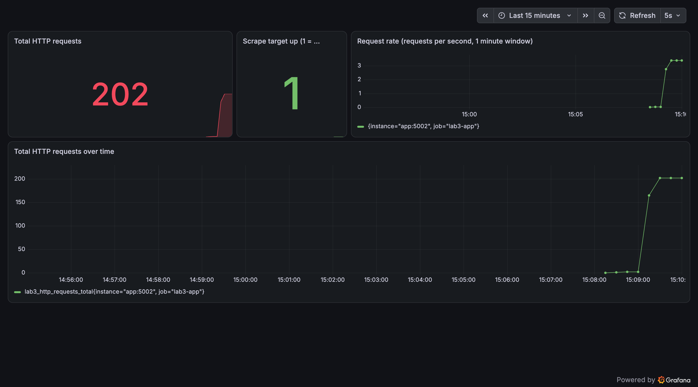

# Lab 3 - Monitoring, Logging & DevSecOps

**Course:** DevOps and Automation Lab (ENSP461)  
**Student:** Aditya Porwal | **GitHub:** `Adityaporwal18`  
**Environment:** Ubuntu 24.04.5 LTS virtual machine, Ansible 2.16.3, Terraform 1.17.2, Docker 29.10.1, ELK 8.17.3, Jenkins 2.580.2. Lab run on 25 November 2026.

## Documentation

| Document | Contents |
|---|---|
| [Lab report](REPORT.md) | Q1-Q7: implementation, measured results, limits and observations |
| [Evidence gallery](docs/EVIDENCE.md) | Screenshots of every step with captions, plus links to the logs |
| [Commands executed](commands.txt) | The commands that were run, grouped by question |
| [Logs](docs/evidence/logs) | Terminal logs, Jenkins console logs and archived scan reports |

## Lab questions and results

| Question | Topic | Result |
|---|---|---|
| Q1 | Ansible configuration | First run `changed=2`, second run `changed=0` (idempotent) |
| Q2 | Terraform provisioning | nginx container created, scaled to 3 and back to 1 |
| Q3 | Prometheus and Grafana | Counter 2 to 202 after 200 requests, shown in both tools |
| Q4 | ELK logging | 40 log events in Elasticsearch and Kibana |
| Q5 | Security in CI/CD | Bandit + pip-audit in Jenkins; gate blocked a High severity issue |
| Q6 | Feature flag, load test, Selenium | Flag toggled by configuration; 2 x 1000 requests with 0 failures; browser test passed |
| Q7 | Report | [REPORT.md](REPORT.md) |



## Run it yourself

Ansible (installs nginx and deploys the page on the local machine):

```bash
ansible-playbook -i ansible/inventory.ini ansible/deploy.yml
```

Terraform (Docker must be running):

```bash
cd terraform
terraform init
terraform apply -var web_count=3
```

Monitoring (copy `monitoring/.env.example` to `monitoring/.env` and set a password first):

```bash
docker compose -f monitoring/compose.yaml up -d --build
```

Application: http://localhost:5002 | Prometheus: http://localhost:9090 | Grafana: http://localhost:3003

Logging (needs about 2.5 GiB of free memory):

```bash
docker compose -f elk/compose.yaml up -d
scripts/send-logs.sh 40
curl 'http://localhost:9200/devops-lab3/_count?pretty'
```

## Main files

```text
ansible/                 Inventory and playbook (nginx + page)
app/index.html           Page deployed by Ansible
terraform/main.tf        nginx image and containers through the Docker provider
monitoring/              Flask app with metrics, Prometheus, Grafana provisioning
elk/                     Elasticsearch, Logstash and Kibana
scripts/send-logs.sh     Sends JSON log events to Logstash
tests/test_selenium.py   Selenium browser test
Jenkinsfile              Bandit scan, security gate, dependency audit
jenkins/job-config.xml   Jenkins job definition
commands.txt             Commands executed in the lab
REPORT.md                Lab report
docs/EVIDENCE.md         Evidence gallery
```
