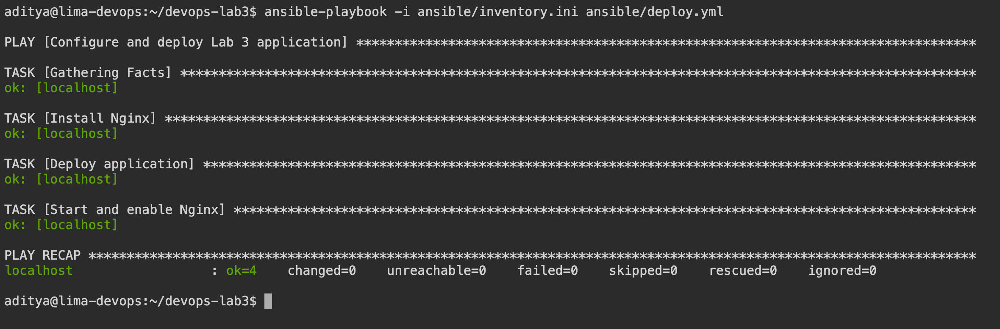
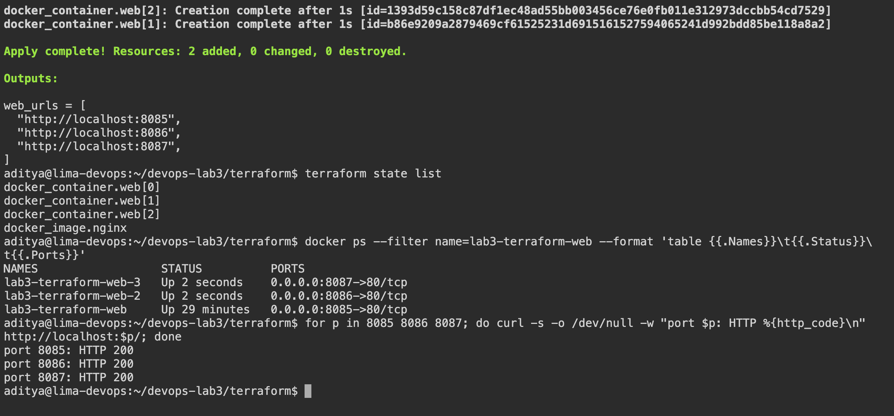
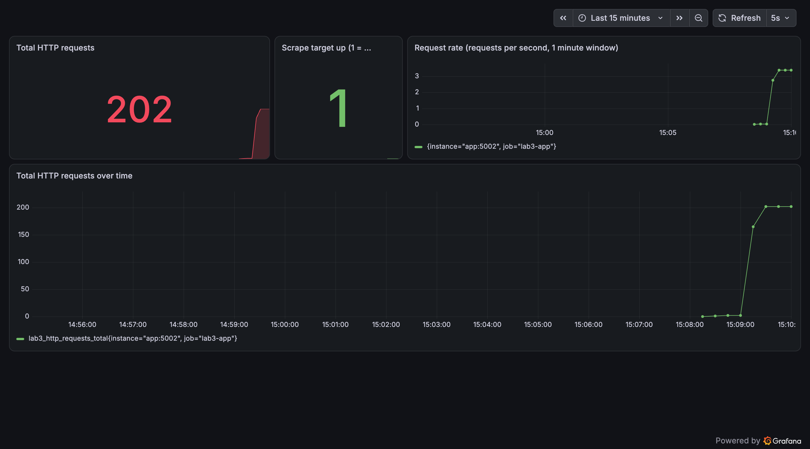
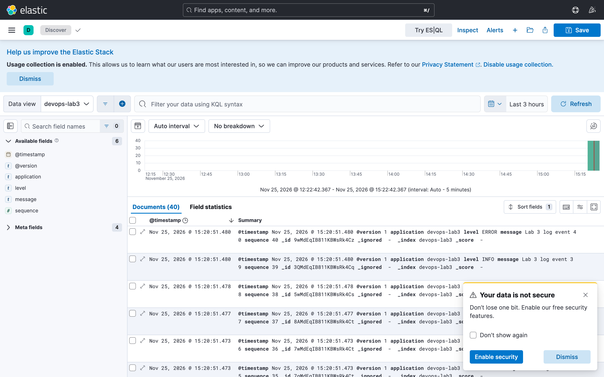
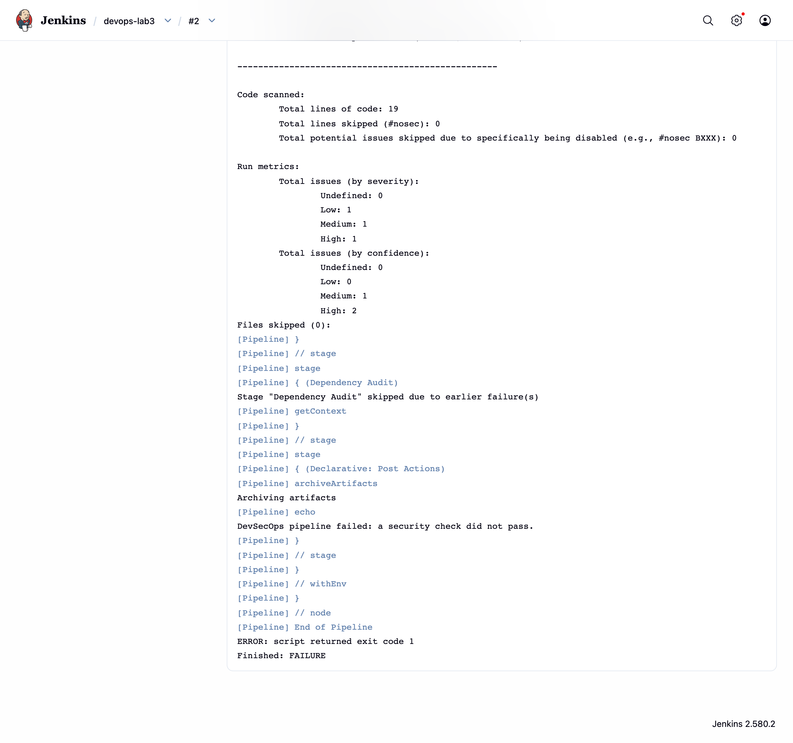
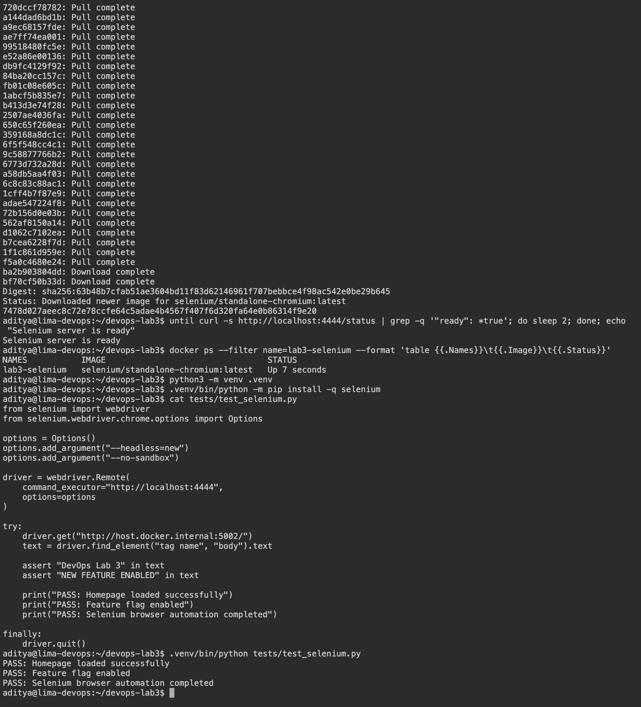
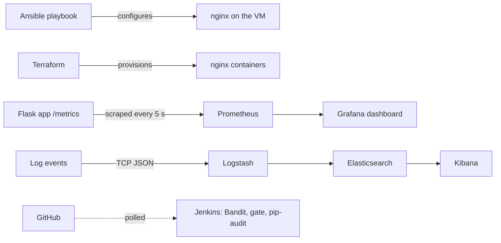

# Lab 3 Report - Monitoring, Logging & DevSecOps

**Course:** DevOps and Automation Lab (ENSP461)  
**Student:** Aditya Porwal  
**Repository:** https://github.com/Adityaporwal18/devops-lab3  
**Environment:** Ubuntu 24.04.5 LTS virtual machine (Lima 2.3.0) on a MacBook Pro (Apple M1, macOS 26.4)  
**Date of this run:** 25 November 2026

[Repository overview](README.md) | [Evidence gallery](docs/EVIDENCE.md) | [Commands executed](commands.txt)

## 1. Objective

To automate infrastructure configuration and provisioning, observe a running application with metrics and centralized logs, add security checks to the CI/CD pipeline, and test the application with a feature flag, load tests and an automated browser test.

## 2. Environment and tools

| Component | Observed value |
|---|---|
| Operating system | Ubuntu 24.04.5 LTS, aarch64 (virtual machine with 4 CPUs and 4 GiB RAM) |
| Ansible | core 2.16.3 |
| Terraform | v1.17.2, provider `kreuzwerker/docker` v3.9.0 |
| Docker / Compose | 29.10.1 / v5.8.0 |
| Monitoring | `prom/prometheus:latest`, `grafana/grafana:latest` |
| Logging | Elasticsearch, Logstash and Kibana 8.17.3 |
| Security tools | Bandit 1.9.4, pip-audit 2.10.1 |
| Testing | ApacheBench 2.3, Selenium 4.54.0 with `selenium/standalone-chromium` |
| Jenkins | 2.580.2, job `devops-lab3` |

Evidence: [tool versions](docs/evidence/screenshots/51-tool-versions.png)

The VM has 3.8 GiB of memory, so the stacks were run one after another: the Lab 4 containers and Minikube were stopped first, and the monitoring stack and Jenkins were stopped while the ELK stack was running.

## Q1 - Configure infrastructure and automate application configuration (Ansible)

**Implementation.** [ansible/inventory.ini](ansible/inventory.ini) defines the group `webservers` with `localhost`. The playbook [ansible/deploy.yml](ansible/deploy.yml) has three tasks: install nginx, copy [app/index.html](app/index.html) to `/var/www/html`, and start and enable the service.

**Results.**

| Run | Recap | Meaning |
|---|---|---|
| Connectivity | `ping: pong` | Ansible can manage the host |
| First run | `ok=4 changed=2 failed=0` | nginx installed and the page deployed |
| Second run | `ok=4 changed=0 failed=0` | Nothing to change: the playbook is idempotent |

`curl http://localhost/` returned HTTP 200 with the deployed page, and nginx is enabled and active.

Evidence: [Q1 in the gallery](docs/EVIDENCE.md#q1---infrastructure-configuration-with-ansible)

## Q2 - Provision scalable infrastructure using Terraform

**Implementation.** [terraform/main.tf](terraform/main.tf) uses the Docker provider to manage an nginx image and nginx containers. The number of containers is a variable (`web_count`), so the infrastructure is scaled by changing one value.

**Results.**

| Step | Command | Result |
|---|---|---|
| Initialise | `terraform init` | Provider v3.9.0 installed |
| Validate and plan | `terraform validate`, `terraform plan -out=tfplan` | Valid; 2 to add |
| Apply | `terraform apply tfplan` | 2 added: image and one container on port 8085 (HTTP 200) |
| Scale out | `terraform apply -var web_count=3` | 2 added: containers on ports 8086 and 8087; all three return HTTP 200 |
| Scale in | `terraform apply -var web_count=1` | The two extra containers are destroyed |

**Scope.** The infrastructure is local Docker containers on one machine. The same workflow (plan, apply, change a variable to scale) applies to cloud resources, but no cloud provider was used. The state file is local and is not committed.

Evidence: [Q2 in the gallery](docs/EVIDENCE.md#q2---scalable-infrastructure-with-terraform)

## Q3 - Set up monitoring using Prometheus and Grafana

**Implementation.** The Flask application in [monitoring/app.py](monitoring/app.py) exposes the counter `lab3_http_requests_total` at `/metrics`. Prometheus scrapes it every 5 seconds ([prometheus.yml](monitoring/prometheus.yml)). Grafana's data source and dashboard are provisioned from files in [monitoring/grafana](monitoring/grafana), so the dashboard is reproducible.

**Results.**

| Check | Before traffic | After 200 requests |
|---|---|---|
| Counter at `/metrics` | 2 | 202 |
| Prometheus query `lab3_http_requests_total` | 2 | 202 |
| Grafana "Total HTTP requests" panel | 2 | 202 |

Prometheus showed the target `lab3-app` as **UP**.

Evidence: [Q3 in the gallery](docs/EVIDENCE.md#q3---monitoring-with-prometheus-and-grafana)

## Q4 - Implement centralized logging using the ELK stack

**Data path.** [scripts/send-logs.sh](scripts/send-logs.sh) sends JSON log lines over TCP to Logstash. The [Logstash pipeline](elk/logstash/pipeline/logstash.conf) writes them to the Elasticsearch index `devops-lab3`. Kibana reads the index through a data view.

**Collection, parsing, visualization.** Logstash collects the events on a TCP input. Its `json_lines` codec parses each line into separate fields (`application`, `level`, `sequence`, `message`), and Logstash adds `@timestamp`. Because the fields are parsed, Elasticsearch can count the events by level, and Kibana shows each field and a histogram of the events over time.

**Results.** 40 log events were sent.

| Check | Result |
|---|---|
| `_count` on the index | 40 |
| Aggregation by level | INFO 28, WARNING 8, ERROR 4 |
| Kibana Discover | Documents (40), with all fields of each event |

**A problem that occurred.** The first count, taken 8 seconds after sending, returned `index_not_found_exception`. The events had been accepted by Logstash but Elasticsearch had not created the index yet. A later count returned 40. Log pipelines are asynchronous, so a check directly after sending can be too early.

**Scope.** Security is disabled in this Elasticsearch (`xpack.security.enabled=false`) and the heap sizes are reduced to fit the VM. That is acceptable for a local lab, not for production. The log events are generated test data, not logs of a real application.

Evidence: [Q4 in the gallery](docs/EVIDENCE.md#q4---centralized-logging-with-the-elk-stack)

## Q5 - Integrate security into the CI/CD pipeline

**Pipeline.** The [Jenkinsfile](Jenkinsfile) has these stages:

| Stage | What it does |
|---|---|
| Install Security Tools | Installs Bandit and pip-audit in a virtual environment |
| Bandit Security Scan | Static analysis of the Python code; the report is printed and archived |
| Security Gate | Fails the build if Bandit reports any **High** severity issue |
| Dependency Audit | `pip-audit` checks `requirements.txt` against known vulnerabilities |

**Findings.**

| Tool | Finding | Severity | Decision |
|---|---|---|---|
| Bandit | B104: the application binds to `0.0.0.0` (`monitoring/app.py`, line 20) | Medium | Accepted: the application runs in a container and must listen on all interfaces to be reachable |
| pip-audit | No known vulnerabilities in 8 packages (Flask 3.1.3, prometheus-client 0.26.0 and their dependencies) | - | Nothing to fix |

**Gate behaviour.**

| Build | Time | Cause | Revision | Outcome |
|---|---|---|---|---|
| #1 | 15:26:04 | Started by user Aditya Porwal | `addccf9` | Gate passed (0 High), audit clean - SUCCESS |
| #2 | 15:29:09 | SCM change: deliberately insecure file | `fdc4a5e` | Gate found B602 (`shell=True`, High) - **FAILURE**, Dependency Audit skipped |
| #3 | 15:31:09 | SCM change: file removed | `1c7fb6c` | Gate passed again - SUCCESS |

Later documentation pushes are scanned automatically in the same way.

**Limits.** The gate only blocks High severity findings, so the Medium finding passes. `requirements.txt` does not pin versions, so the audit checks whatever versions are current on the day of the build. Bandit and pip-audit do not scan the container images.

Evidence: [Q5 in the gallery](docs/EVIDENCE.md#q5---security-in-the-cicd-pipeline)

## Q6 - Feature flags, load testing and Selenium

**Feature flag.** The application reads `ENABLE_NEW_FEATURE`. Recreating the container with the value `true` changed the page from *Prometheus Monitoring* to *NEW FEATURE ENABLED* without changing code or rebuilding the image.

**Load tests.** ApacheBench, 1000 requests, concurrency 20, one run with the flag off and one with it on.

| Metric | Run A (flag off) | Run B (flag on) |
|---|---|---|
| Failed requests | 0 | 0 |
| Requests per second | 1560.74 | 1510.49 |
| Mean time per request | 12.814 ms | 13.241 ms |
| 50% / 90% / 95% / 99% | 11 / 14 / 19 / 29 ms | 12 / 17 / 23 / 28 ms |
| Longest request | 42 ms | 33 ms |

The two runs differ by about 3%. Each is a single short run on a shared VM, so this difference is within normal variation and does not show that the flag affects performance.

**Selenium.** [tests/test_selenium.py](tests/test_selenium.py) drives a Chromium browser in a Selenium container, opens the application and checks the page text. All three checks passed.

Evidence: [Q6 in the gallery](docs/EVIDENCE.md#q6---feature-flags-load-testing-and-selenium)

## Q7 - Report and documentation

| Record | Location |
|---|---|
| Configuration and provisioning | [ansible](ansible), [terraform/main.tf](terraform/main.tf) |
| Monitoring | [monitoring](monitoring) |
| Logging | [elk](elk), [scripts/send-logs.sh](scripts/send-logs.sh) |
| Pipeline | [Jenkinsfile](Jenkinsfile), [jenkins/job-config.xml](jenkins/job-config.xml) |
| Commands | [commands.txt](commands.txt) (extracted from the terminal logs) |
| Screenshots with captions | [docs/EVIDENCE.md](docs/EVIDENCE.md) |
| Terminal logs, Jenkins console logs, archived scan reports | [docs/evidence/logs](docs/evidence/logs) |

### Architecture

### Observations

- An idempotent playbook can be run repeatedly; only the first run changed the system.
- Terraform kept the existing container when scaling from one to three and only added the two new ones.
- The metric value was identical in the application, Prometheus and Grafana, which confirms the whole monitoring path.
- Log data arrived with a short delay; the first check was too early.
- The security gate stopped a commit with a High severity issue and skipped the remaining stage.
- A feature flag changed behaviour by configuration alone.

## Conclusion

Infrastructure was configured with Ansible and provisioned and scaled with Terraform. The application was monitored with Prometheus and Grafana, and log events were collected in Elasticsearch and viewed in Kibana. The Jenkins pipeline scans code and dependencies and blocks High severity findings. A feature flag, two load tests and a Selenium test completed the lab. Everything ran on one local VM, so the results show that each mechanism works; they are not production measurements.
