# Lab 3 Evidence - Monitoring, Logging & DevSecOps

All evidence on this page was captured on **25 November 2026** while running Lab 3 in an **Ubuntu 24.04.5 LTS virtual machine** (Lima 2.3.0 on a MacBook Pro with Apple M1, macOS 26.4).

**How it was captured.** Terminal screenshots show the VM's shell session through a browser-based terminal (ttyd attached to tmux). Web screenshots (the application, Prometheus, Grafana, Kibana, Jenkins, GitHub) were taken with headless Google Chrome on the Mac through forwarded ports. The capture is automated. Terminal screenshots are cropped below the last line of output; nothing else is edited. Every terminal screenshot has a text log with the complete output under [evidence/logs](evidence/logs).

Evidence is grouped by lab question. The number at the start of each file name gives the order in which the steps were actually run.

[Project overview](../README.md) | [Lab report](../REPORT.md) | [Commands](../commands.txt)

| Section | Evidence |
|---|---|
| [Q1 - Infrastructure configuration with Ansible](#q1---infrastructure-configuration-with-ansible) | E01-E08 |
| [Q2 - Scalable infrastructure with Terraform](#q2---scalable-infrastructure-with-terraform) | E09-E17 |
| [Q3 - Monitoring with Prometheus and Grafana](#q3---monitoring-with-prometheus-and-grafana) | E18-E25 |
| [Q4 - Centralized logging with the ELK stack](#q4---centralized-logging-with-the-elk-stack) | E26-E31 |
| [Q5 - Security in the CI/CD pipeline](#q5---security-in-the-cicd-pipeline) | E32-E46 |
| [Q6 - Feature flags, load testing and Selenium](#q6---feature-flags-load-testing-and-selenium) | E47-E53 |
| [Q7 - Report and repository](#q7---report-and-repository) | E54-E54 |

## Q1 - Infrastructure configuration with Ansible

### E01 - Clone the repository and remove outdated evidence

The GitHub repository is cloned into `~/devops-lab3` (existing commit `b18a157`). The earlier evidence, scan reports, documents and Terraform plan files are removed with `git rm` and committed (57 files), so that only evidence from this run remains.

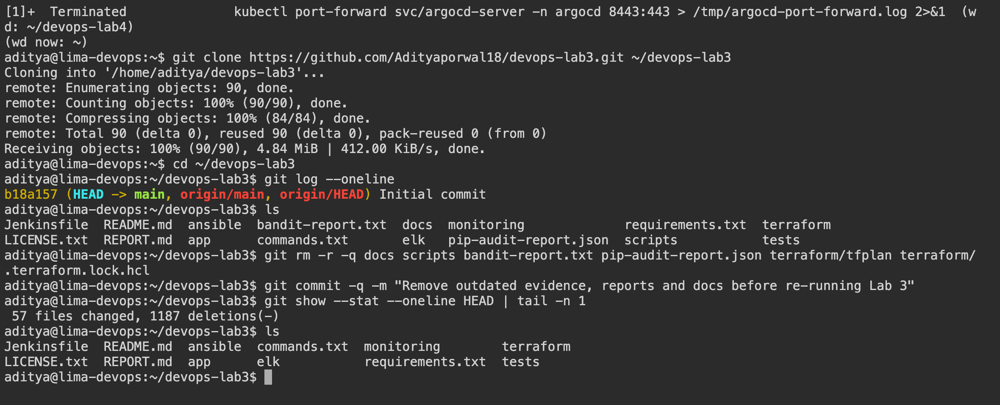

Source: [Terminal log](evidence/logs/01-clone-repo-remove-outdated-evidence.txt)

### E02 - Free memory before the lab

The Lab 4 containers and Minikube are stopped because the VM has 3.8 GiB of memory. `free -h` then shows 2.4 GiB available.

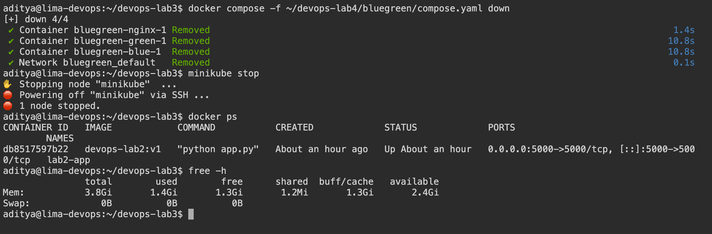

Source: [Terminal log](evidence/logs/02-stop-lab4-stacks-to-free-memory.txt)

### E03 - Install Ansible

A licence text file that did not belong to the project is removed. `sudo apt install ansible apache2-utils -y` installs Ansible and ApacheBench; `ansible --version` reports core 2.16.3.

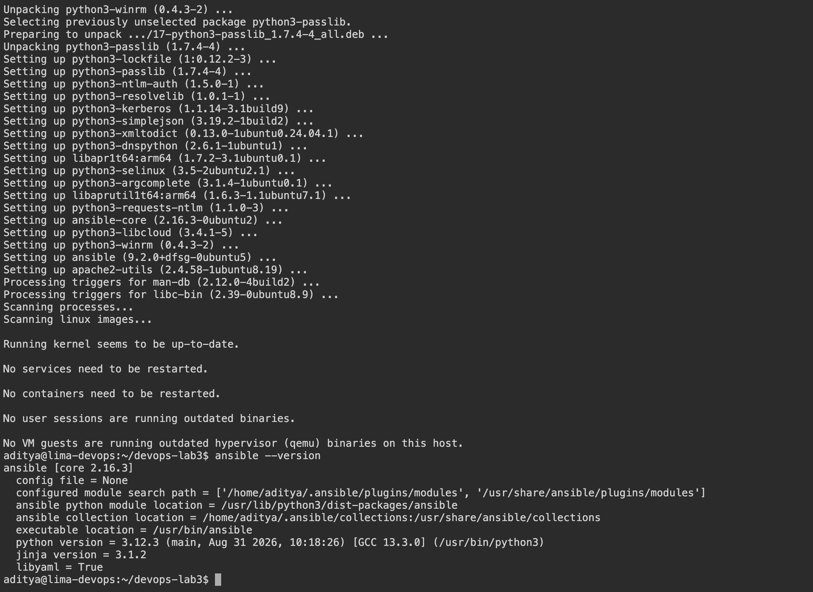

Source: [Terminal log](evidence/logs/03-install-ansible.txt)

### E04 - Inventory, playbook and connectivity

The inventory defines the group `webservers` with `localhost` (local connection). The playbook installs nginx, copies `app/index.html` and starts the service. `ansible -m ping` returns `pong`.

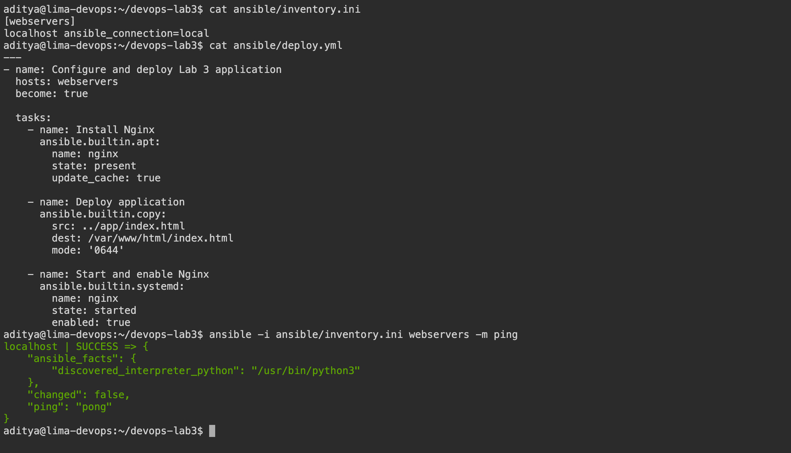

Source: [Terminal log](evidence/logs/05-ansible-inventory-playbook-ping.txt)

### E05 - First playbook run

First run of `ansible-playbook`: *Install Nginx* and *Deploy application* report `changed`, and the recap shows `ok=4 changed=2 failed=0`.

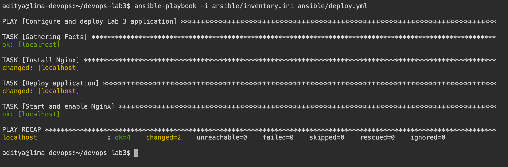

Source: [Terminal log](evidence/logs/06-ansible-first-run.txt)

### E06 - nginx serves the deployed page

nginx is enabled and active, `curl` returns HTTP 200 and the page deployed by Ansible.

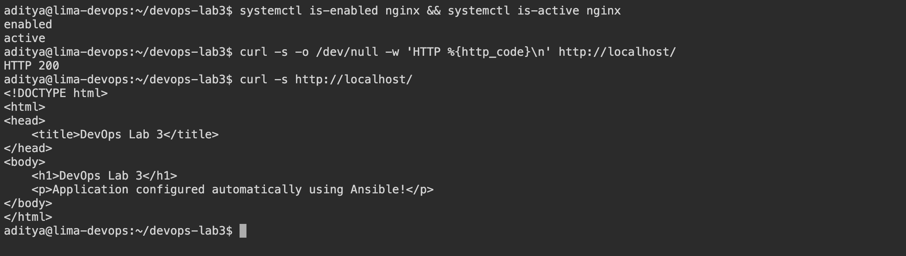

Source: [Terminal log](evidence/logs/07-ansible-nginx-serving-page.txt)

### E07 - Second run is idempotent

Running the same playbook again changes nothing: `ok=4 changed=0 failed=0`.

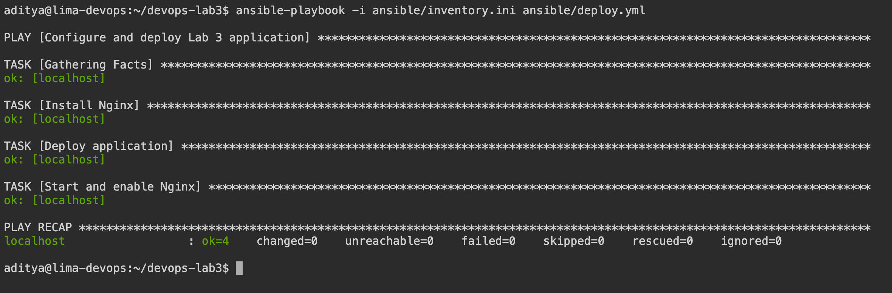

Source: [Terminal log](evidence/logs/08-ansible-second-run-idempotent.txt)

### E08 - Deployed page in the browser

The page on port 80 opened in a browser: *Application configured automatically using Ansible!*

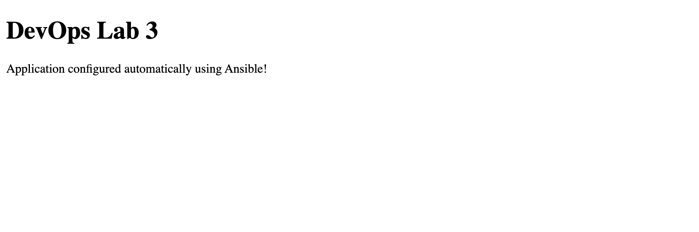

## Q2 - Scalable infrastructure with Terraform

### E09 - Install Terraform

HashiCorp's apt repository is added and Terraform is installed: v1.17.2 on linux_arm64.

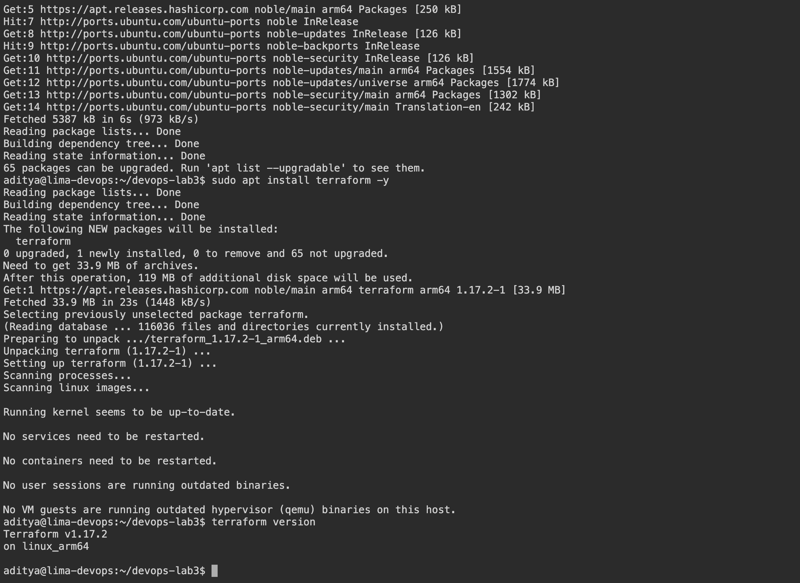

Source: [Terminal log](evidence/logs/04-install-terraform.txt)

### E10 - terraform init

`main.tf` describes an nginx image and container through the `kreuzwerker/docker` provider. `terraform init` installs provider v3.9.0 and reports a successful initialisation.

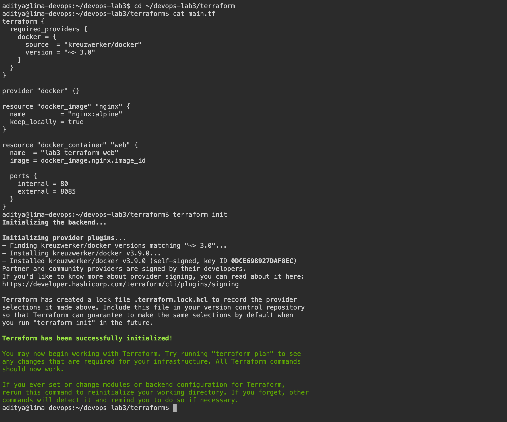

Source: [Terminal log](evidence/logs/10-terraform-init.txt)

### E11 - Validate and plan

`terraform fmt -check` and `terraform validate` succeed. `terraform plan -out=tfplan` proposes **2 to add, 0 to change, 0 to destroy**. Only the end of the plan is visible; the text log has all of it.

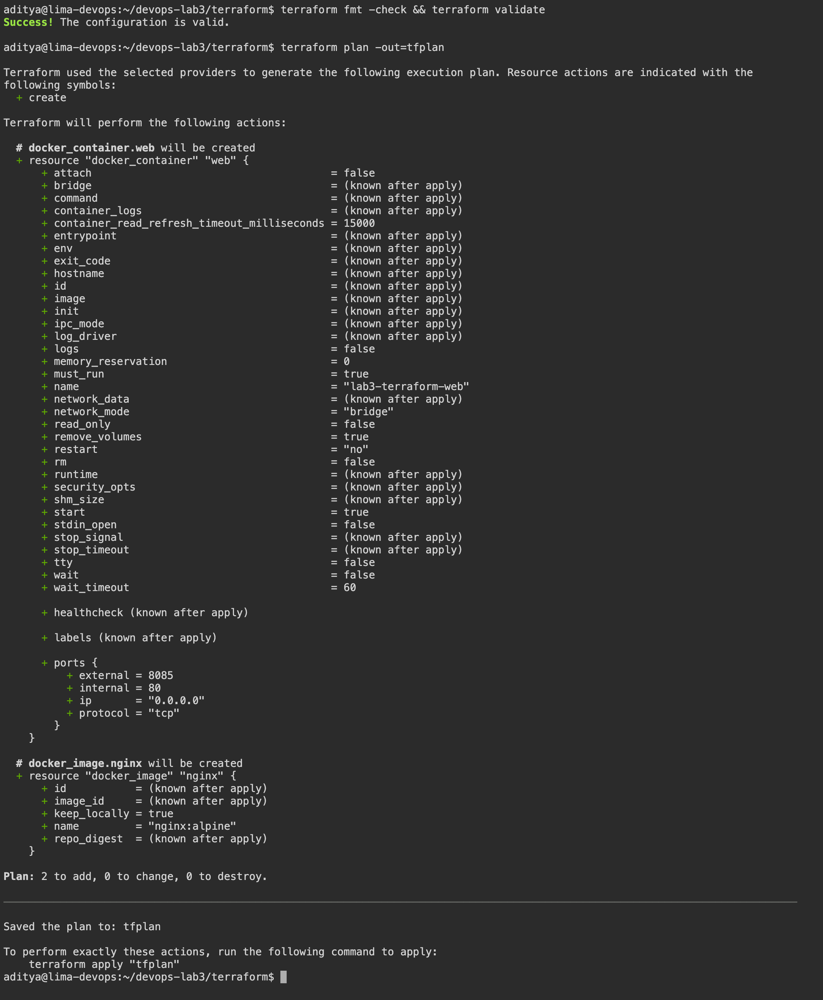

Source: [Terminal log](evidence/logs/11-terraform-validate-plan.txt)

### E12 - Apply, state and running container

`terraform apply` creates the image and container resources (**2 added**). `terraform state list` shows both, `docker ps` shows `lab3-terraform-web` on port 8085 and `curl` returns HTTP 200.

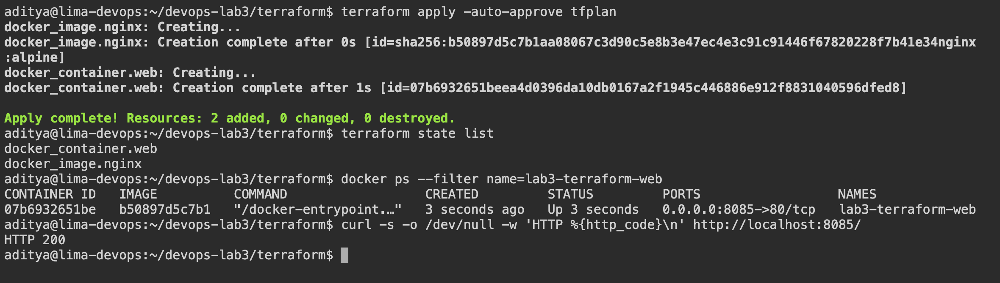

Source: [Terminal log](evidence/logs/12-terraform-apply-state-container.txt)

### E13 - Terraform-provisioned nginx in the browser

The container created by Terraform answers on port 8085 with the nginx welcome page.

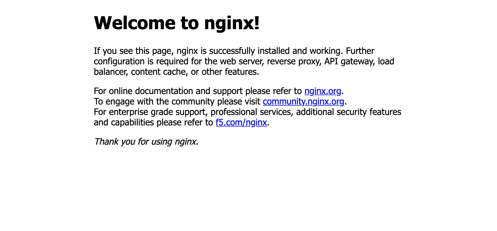

### E14 - Files created by Terraform

`git status` shows the new dependency lock file and the saved plan. The lock file is committed later; the plan and state files are ignored by `.gitignore`.

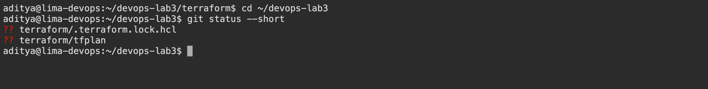

Source: [Terminal log](evidence/logs/14-terraform-files-status.txt)

### E15 - Scaling: plan for three containers

A `web_count` variable and `count` are added to `main.tf`. With `-var web_count=3` the plan keeps the existing container and adds `lab3-terraform-web-2` (port 8086) and `lab3-terraform-web-3` (port 8087): **2 to add, 0 to change, 0 to destroy**.

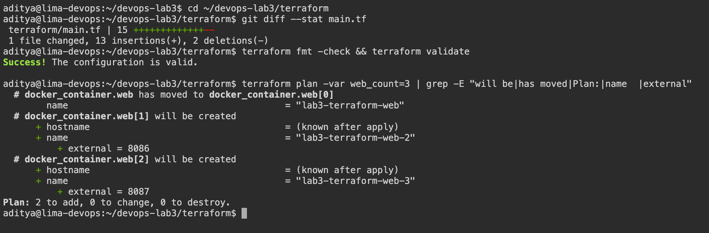

Source: [Terminal log](evidence/logs/52-terraform-scale-plan.txt)

### E16 - Scaling: three containers running

After `terraform apply -var web_count=3` the state lists three containers, `docker ps` shows all three and ports 8085, 8086 and 8087 each return HTTP 200.

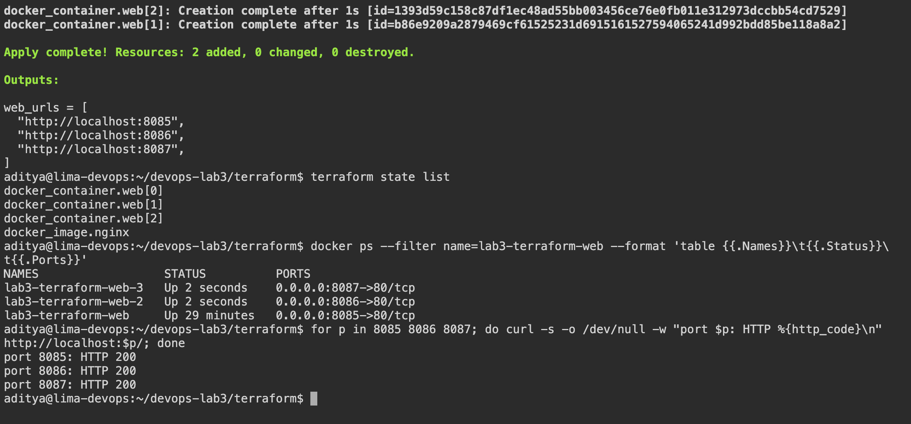

Source: [Terminal log](evidence/logs/53-terraform-scale-to-three-containers.txt)

### E17 - Scaling back to one container

`terraform apply -var web_count=1` removes the two extra containers. The state and `docker ps` show one container again.

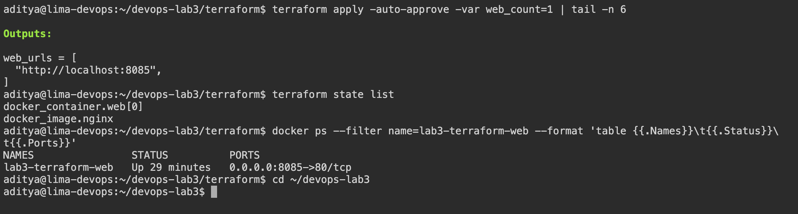

Source: [Terminal log](evidence/logs/54-terraform-scale-back-to-one.txt)

## Q3 - Monitoring with Prometheus and Grafana

### E18 - Start the monitoring stack

The Grafana provisioning files are committed, the Prometheus scrape configuration is shown and `docker compose up` starts the application (port 5002), Prometheus (9090) and Grafana (3003). The application answers and `/metrics` exposes the counter `lab3_http_requests_total` with value 1.

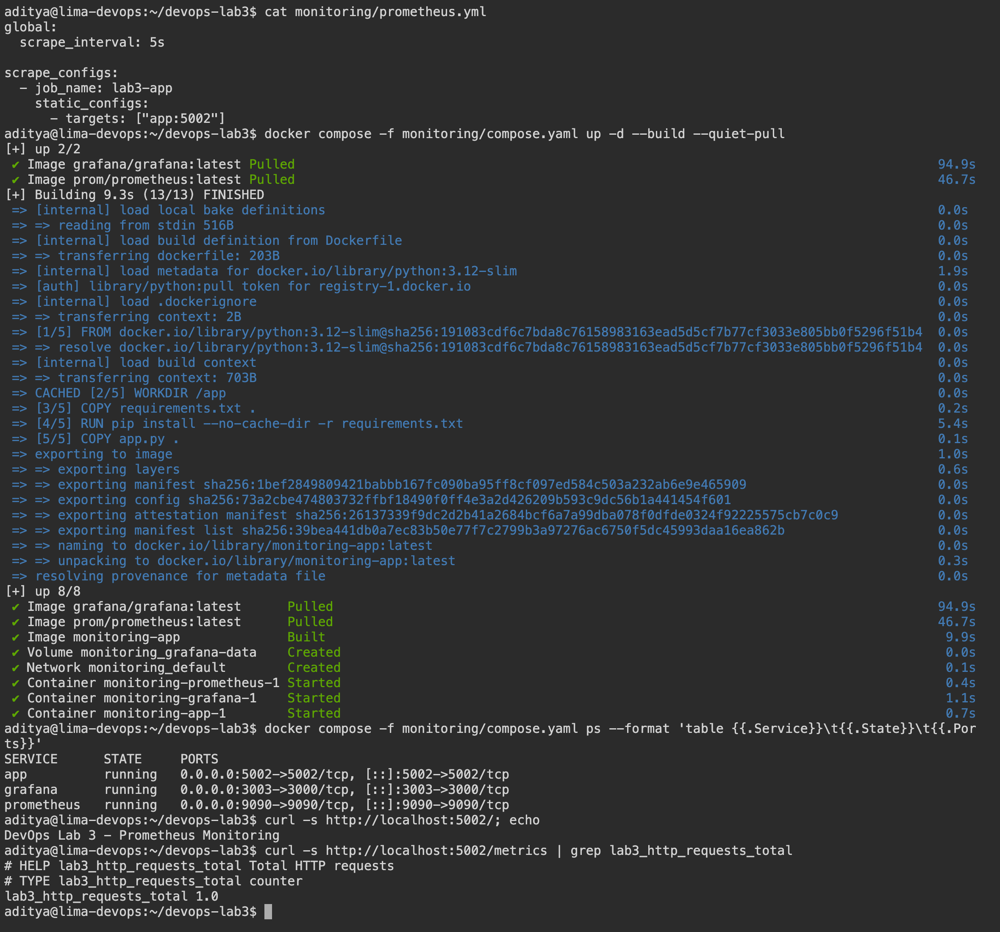

Source: [Terminal log](evidence/logs/15-monitoring-stack-start.txt)

### E19 - Application homepage

The monitored Flask application in a browser: *DevOps Lab 3 - Prometheus Monitoring*.

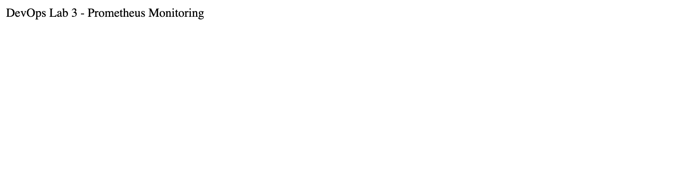

### E20 - Prometheus target is UP

Prometheus's target health page: the job `lab3-app` with endpoint `http://app:5002/metrics` is **UP** (1/1).

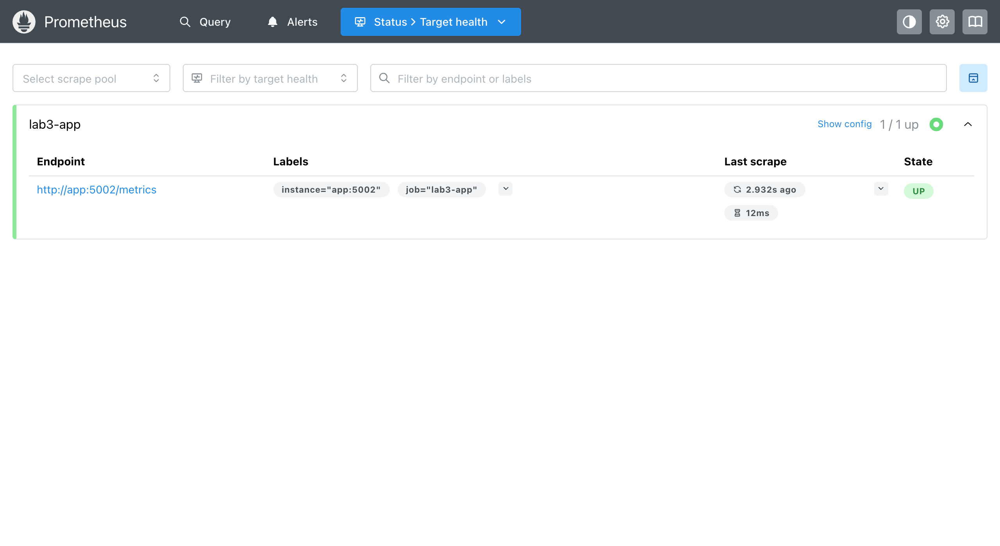

### E21 - Request counter before traffic

The query `lab3_http_requests_total` in Prometheus returns 2 before the traffic test.

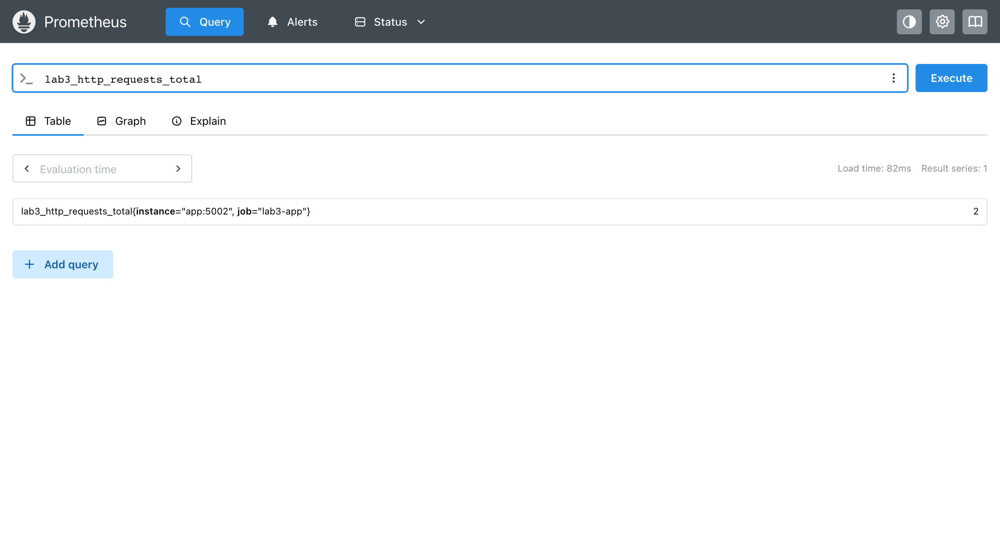

### E22 - Grafana dashboard before traffic

The provisioned Grafana dashboard *Lab 3 - Application Monitoring* before the traffic test: total requests 2, scrape target up = 1.

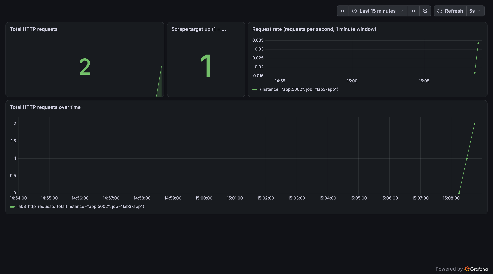

### E23 - Generate HTTP traffic

The counter is 2 before, 200 requests are sent with `curl`, and the counter is 202 afterwards. Prometheus's API returns the value `202`.

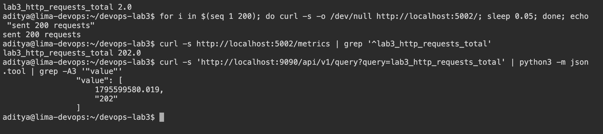

Source: [Terminal log](evidence/logs/20-generate-http-traffic.txt)

### E24 - Request counter after traffic

The same Prometheus query now returns 202.

### E25 - Grafana dashboard after traffic

The Grafana dashboard after the traffic test: total requests 202, the counter graph rises from 2 to 202 and the request-rate panel shows the burst.

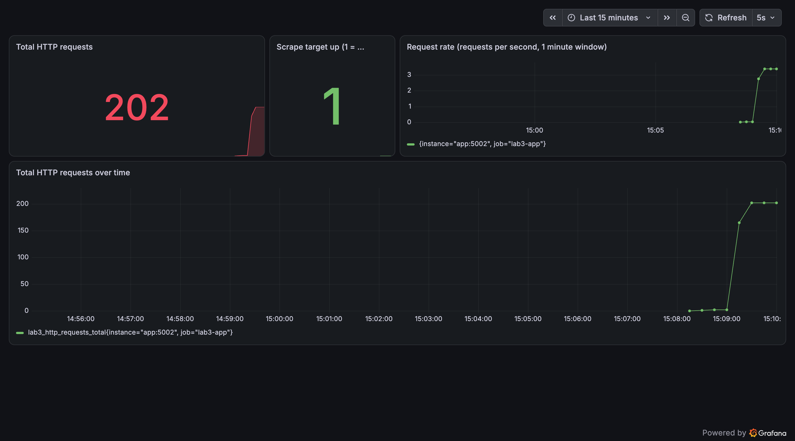

## Q4 - Centralized logging with the ELK stack

### E26 - Start the ELK stack

The monitoring stack and Jenkins are stopped to free memory. The Logstash pipeline (TCP input with JSON lines, output to the index `devops-lab3`) is shown and `docker compose up` starts Elasticsearch, Logstash and Kibana. Elasticsearch reports version 8.17.3.

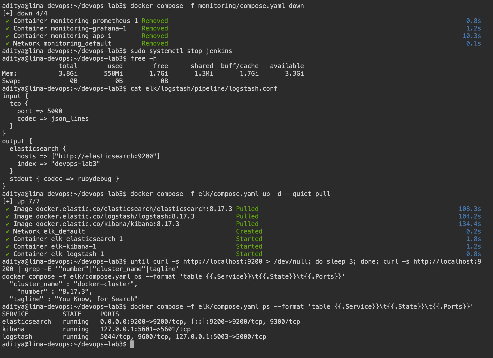

Source: [Terminal log](evidence/logs/30-elk-stack-start.txt)

### E27 - Send 40 log events (first count too early)

After Logstash reports that its pipeline is running, `send-logs.sh` sends 40 JSON log events to Logstash on port 5003. The count taken 8 seconds later returns `index_not_found_exception` (HTTP 404): Elasticsearch had not created the index yet.

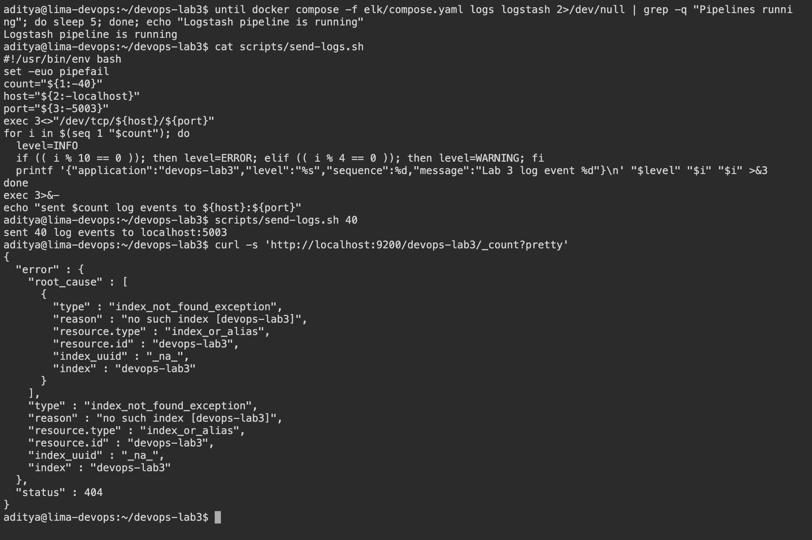

Source: [Terminal log](evidence/logs/31-send-logs-first-count-too-early.txt)

### E28 - Kibana ready, data view created

The terminal waits until Kibana's status is *available* and creates the data view `devops-lab3` through Kibana's API. All three services are running.

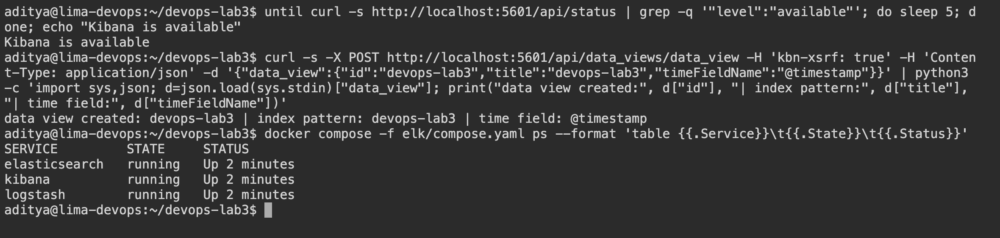

Source: [Terminal log](evidence/logs/32-kibana-ready-data-view-created.txt)

### E29 - Elasticsearch holds 40 documents

Checked again a little later: `_count` returns **40**, the index `devops-lab3` lists 40 documents, the newest document is log event 40 with level ERROR, and the aggregation by level gives INFO 28, WARNING 8, ERROR 4.

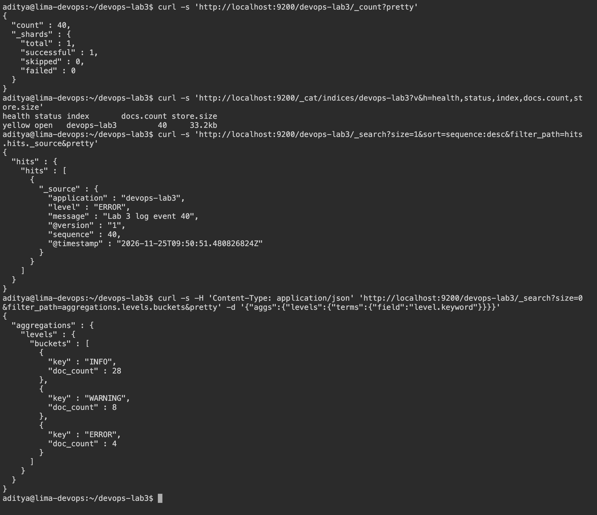

Source: [Terminal log](evidence/logs/33-elasticsearch-40-documents.txt)

### E30 - Kibana Discover

Kibana Discover with the data view `devops-lab3`: **Documents (40)**, the histogram bar for the time the events were sent, and the individual log events with their fields.

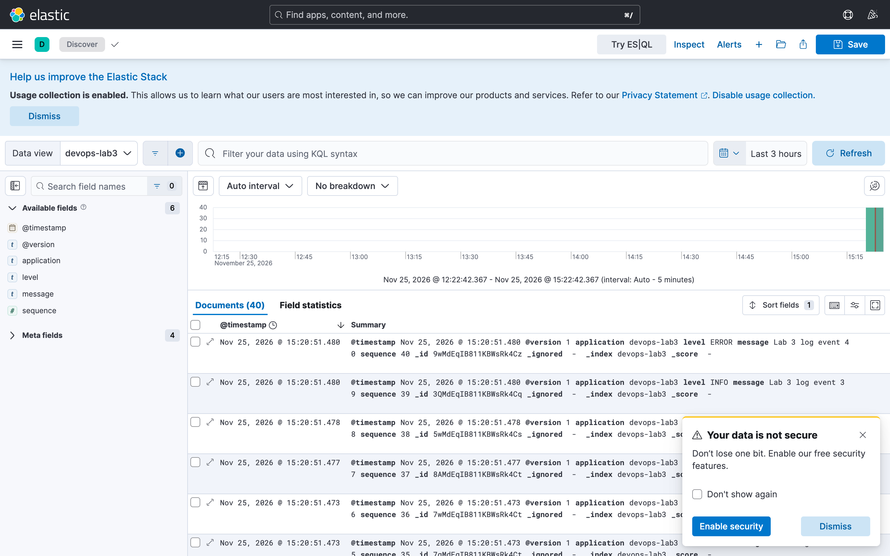

### E31 - ELK memory use, then stop

The three ELK containers and their memory use (Elasticsearch about 1.0 GiB, Kibana 636 MiB, Logstash 534 MiB). The stack is then stopped and Jenkins is started again.

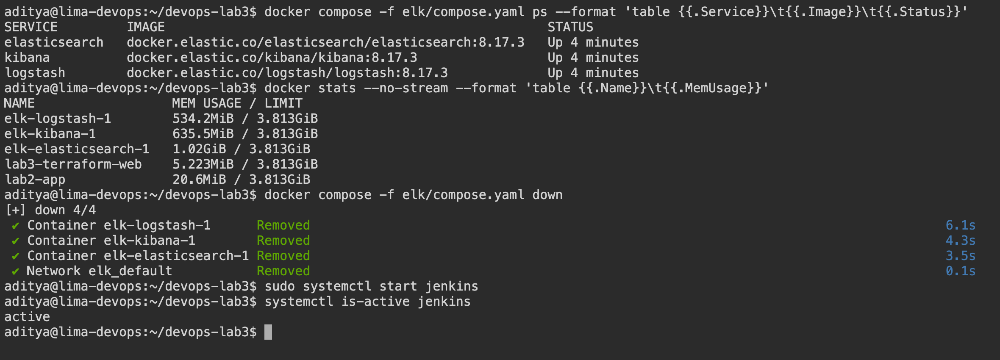

Source: [Terminal log](evidence/logs/35-elk-containers-then-stop.txt)

## Q5 - Security in the CI/CD pipeline

### E32 - Bandit scan

Bandit scans `app` and `monitoring` and reports one finding: **B104, binding to all interfaces**, severity Medium, in `monitoring/app.py` line 20. There are no High findings.

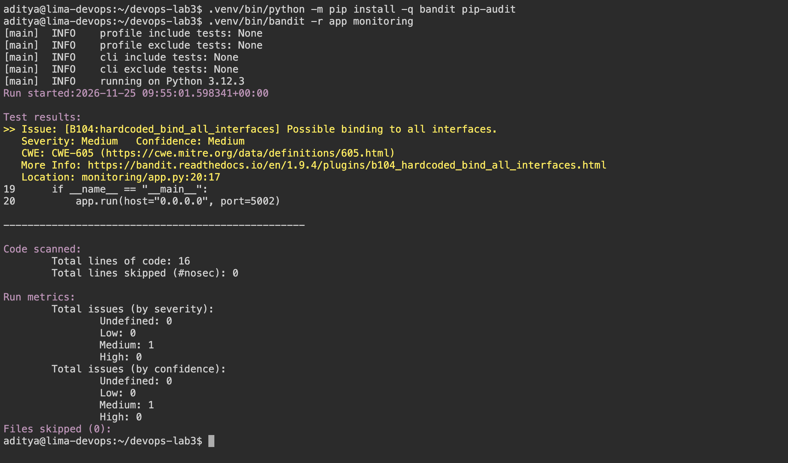

Source: [Terminal log](evidence/logs/36-bandit-scan-local.txt)

### E33 - Dependency audit and gate rule

`pip-audit -r requirements.txt` reports *No known vulnerabilities found*. The gate command (`bandit -lll`, High severity only) exits with code 0.

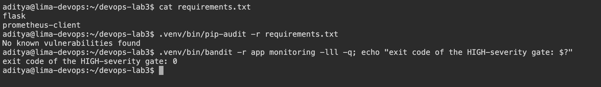

Source: [Terminal log](evidence/logs/37-pip-audit-and-gate-local.txt)

### E34 - Commit and push the pipeline

The Jenkinsfile with the Security Gate stage, the ELK heap limits, the log sender and the Jenkins job configuration are committed (`addccf9`) and all commits are pushed to GitHub.

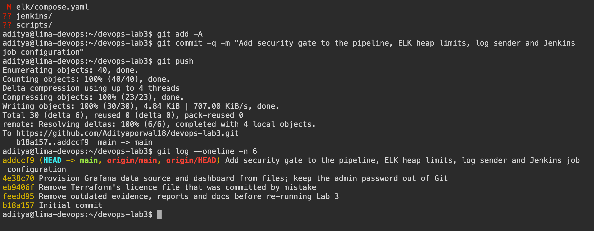

Source: [Terminal log](evidence/logs/38-commit-and-push-lab-work.txt)

### E35 - Build #1 console - start

Build #1 of the Jenkins job `devops-lab3` is **Started by user Aditya Porwal** and checks out revision `addccf9` from the GitHub repository.

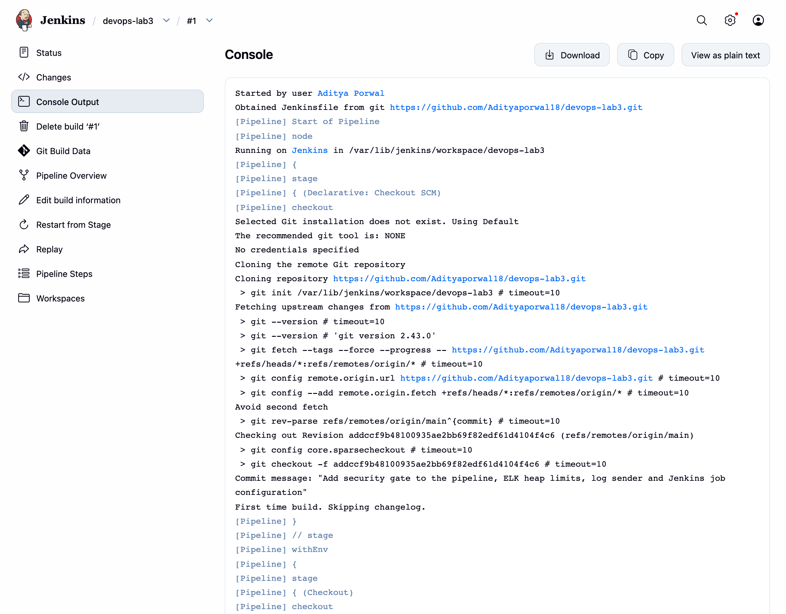

Source: [Full console log](evidence/logs/jenkins-build-1-console.txt)

### E36 - Build #1 - Bandit finding in the pipeline

The Bandit stage in Jenkins reports the same Medium finding (B104) and no High findings.

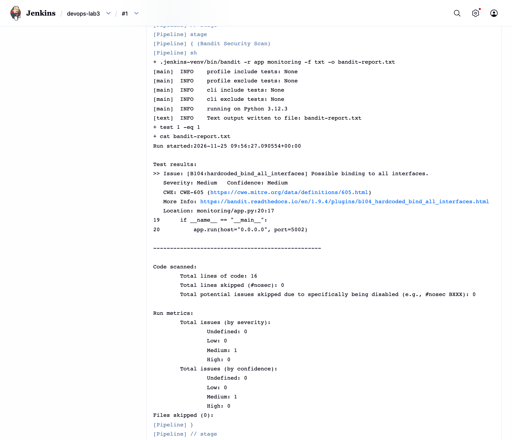

Source: [Bandit report archived by the build](evidence/logs/jenkins-build-1-bandit-report.txt)

### E37 - Build #1 - gate passed, audit clean

The Security Gate prints `No HIGH severity issue found. Gate passed.`, the dependency audit finds no known vulnerabilities, the reports are archived and the build ends with **Finished: SUCCESS**.

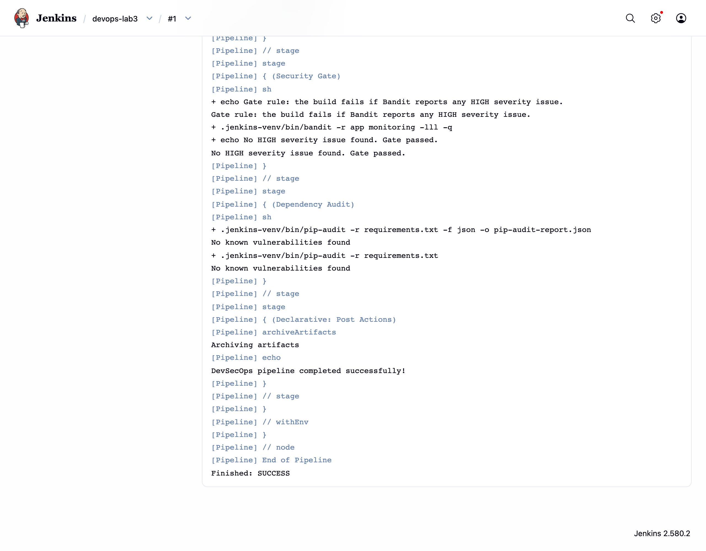

Source: [pip-audit report archived by the build](evidence/logs/jenkins-build-1-pip-audit-report.json)

### E38 - Build #1 pipeline stages

Stage view of build #1: Checkout, Install Security Tools, Bandit Security Scan, Security Gate and Dependency Audit all succeeded.

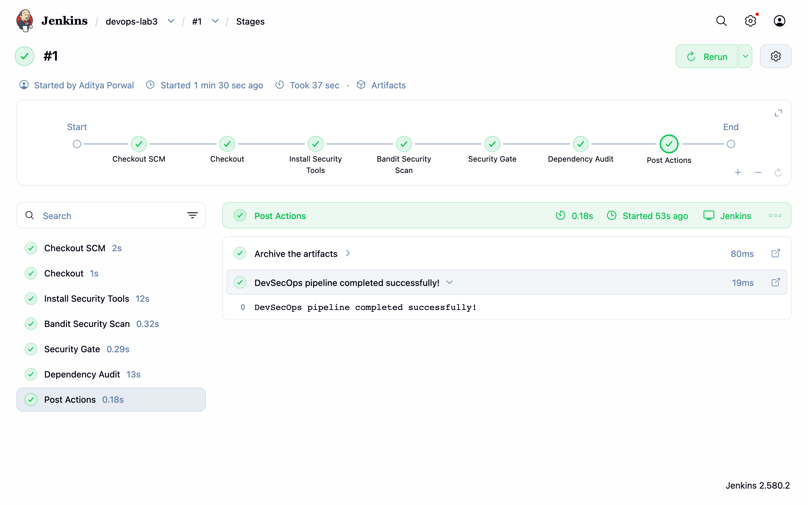

### E39 - Archived scan reports

The build page lists the archived artifacts `bandit-report.txt` and `pip-audit-report.json`.

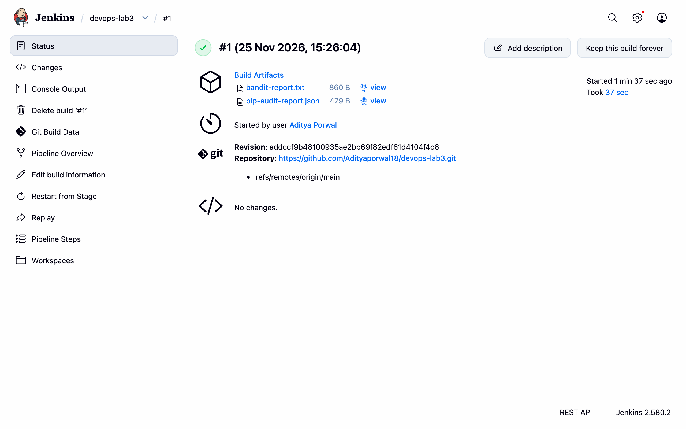

### E40 - Commit deliberately insecure code

A small file that calls `subprocess` with `shell=True` is added to test the gate. Locally Bandit reports **B602, severity High** and the gate command exits with code 1. The file is committed (`fdc4a5e`) and pushed at 15:27:55 IST.

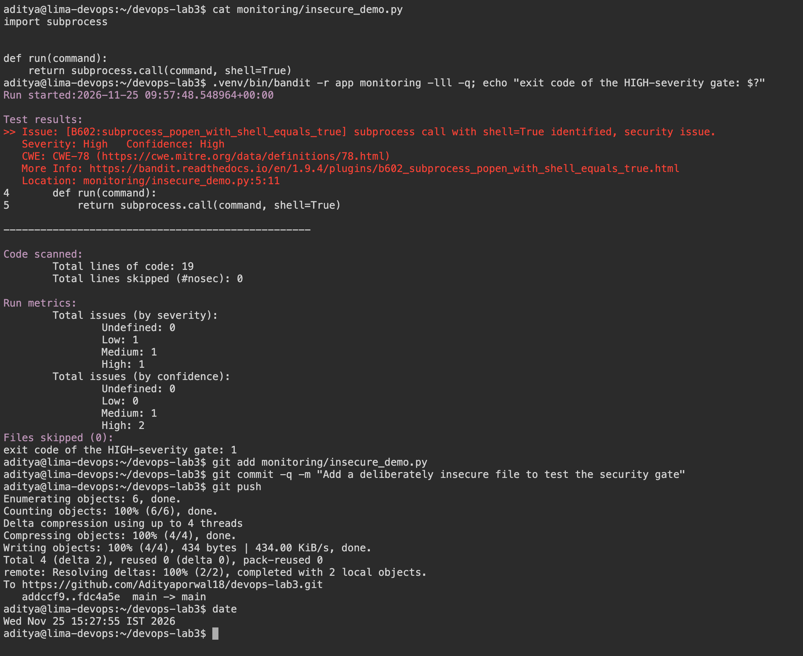

Source: [Terminal log](evidence/logs/44-commit-deliberately-insecure-code.txt)

### E41 - Build #2 started by an SCM change

Polling detects the pushed commit and build #2 begins with **Started by an SCM change**.

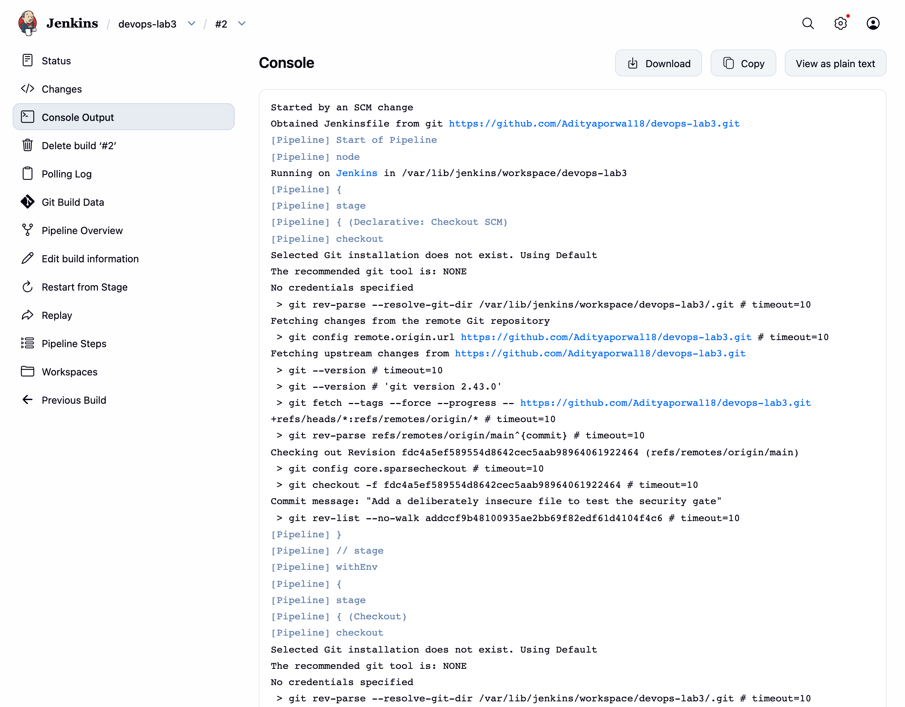

Source: [Full console log](evidence/logs/jenkins-build-2-console.txt)

### E42 - Build #2 - security gate failed

The Security Gate finds the High severity issue B602 and fails. The Dependency Audit stage is *skipped due to earlier failure(s)*, the post action prints that a security check did not pass, and the build ends with **Finished: FAILURE**.

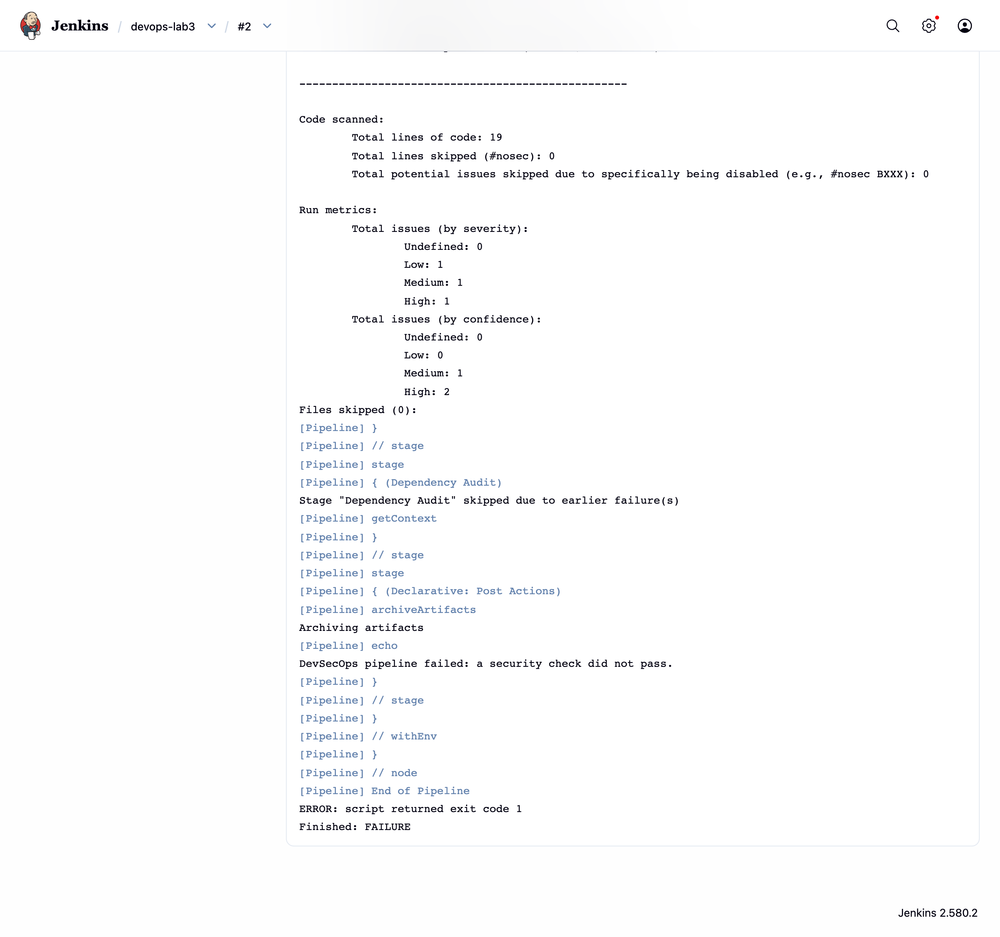

Source: [Full console log](evidence/logs/jenkins-build-2-console.txt)

### E43 - Build #2 pipeline stages

Stage view of build #2: the Security Gate stage failed and the Dependency Audit did not run.

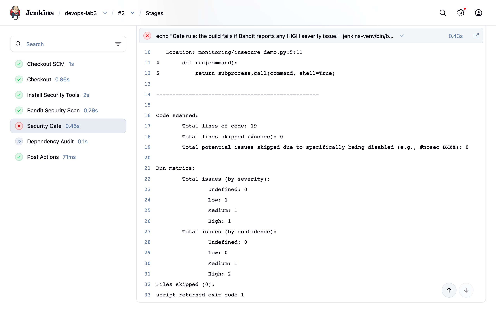

### E44 - Remove the insecure code

The insecure file is removed, the gate command exits with 0 again, and the removal is committed (`1c7fb6c`) and pushed at 15:29:59 IST.

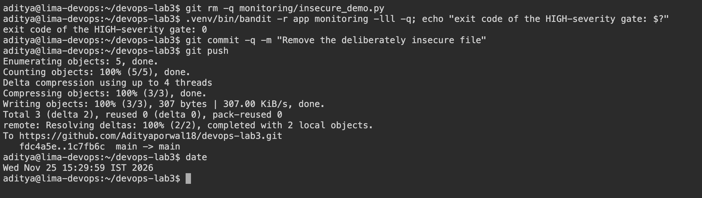

Source: [Terminal log](evidence/logs/48-remove-insecure-code.txt)

### E45 - Build #3 - gate passed again

Build #3 (started by polling): no High findings, the gate passes, the audit is clean and the build ends with **Finished: SUCCESS**.

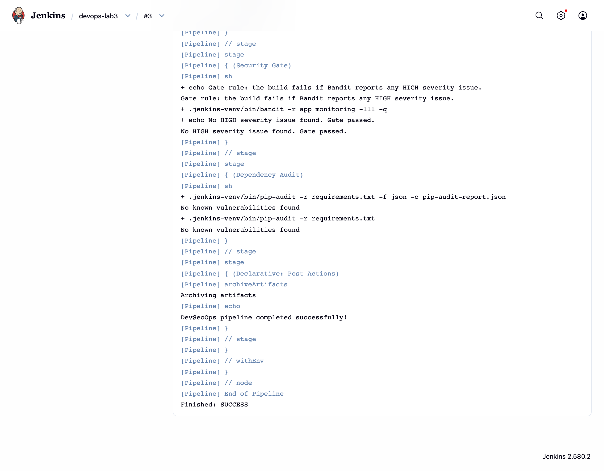

Source: [Full console log](evidence/logs/jenkins-build-3-console.txt)

### E46 - Build history: pass, fail, pass

Job page of `devops-lab3`: #1 successful, #2 failed (deliberately insecure code), #3 successful.

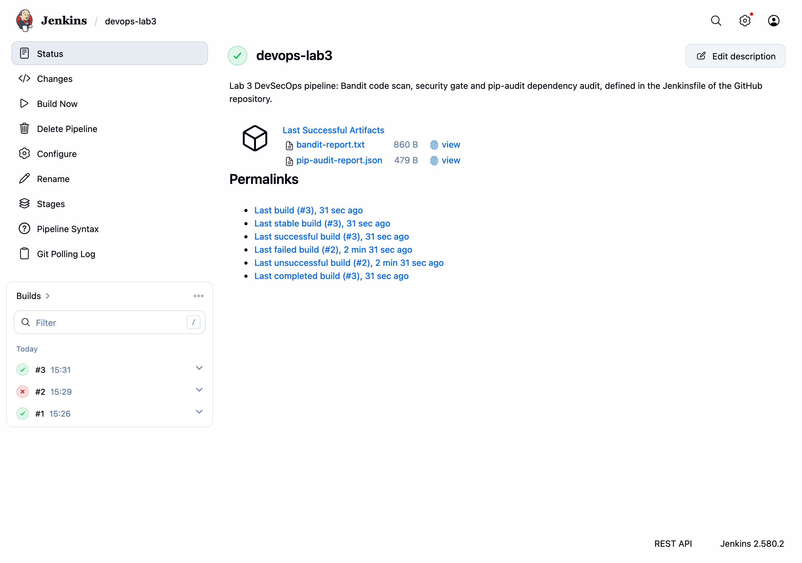

## Q6 - Feature flags, load testing and Selenium

### E47 - Feature flag off

The application reads the environment variable `ENABLE_NEW_FEATURE`. With the value `false` the page is *DevOps Lab 3 - Prometheus Monitoring*.

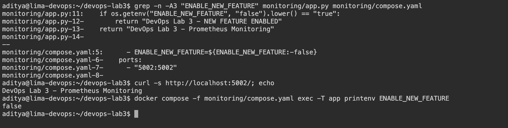

Source: [Terminal log](evidence/logs/23-feature-flag-off.txt)

### E48 - Load test run A (flag off)

ApacheBench, 1000 requests with concurrency 20, feature flag off: 0 failed requests, 1560.74 requests per second, mean 12.814 ms per request, 95% of requests within 19 ms.

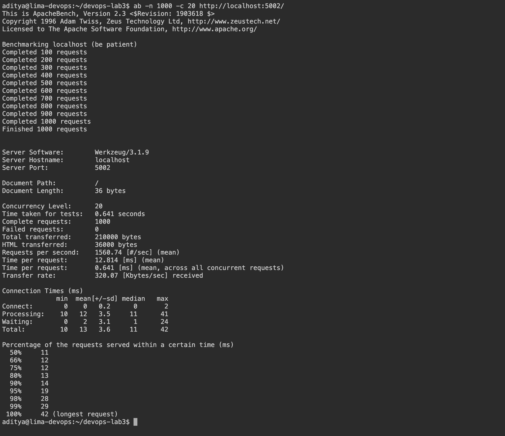

Source: [Terminal log](evidence/logs/24-load-test-run-a-flag-off.txt)

### E49 - Feature flag on

The application container is recreated with `ENABLE_NEW_FEATURE=true`. The page changes to *DevOps Lab 3 - NEW FEATURE ENABLED* without a code change or image rebuild.

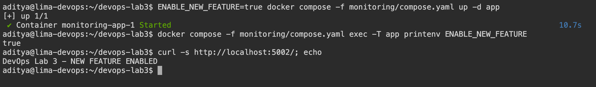

Source: [Terminal log](evidence/logs/25-feature-flag-on.txt)

### E50 - New feature in the browser

The application in a browser with the flag on: *DevOps Lab 3 - NEW FEATURE ENABLED*.

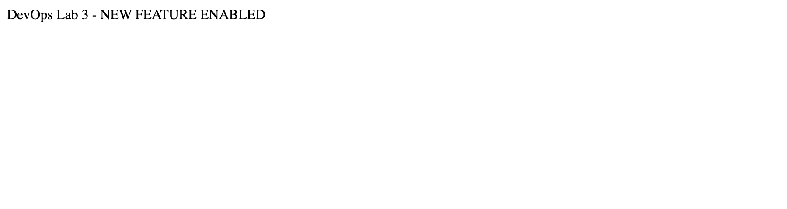

### E51 - Load test run B (flag on)

The same load test with the feature flag on: 0 failed requests, 1510.49 requests per second, mean 13.241 ms per request, 95% of requests within 23 ms.

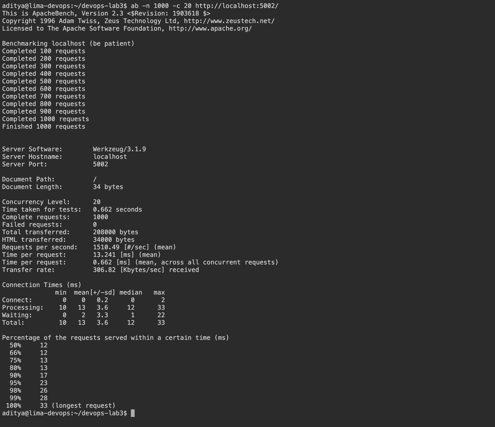

Source: [Terminal log](evidence/logs/27-load-test-run-b-flag-on.txt)

### E52 - Selenium browser test

A Selenium server with Chromium runs in a container. The test script opens the application in that browser, checks the page text and prints three PASS lines.

Source: [Terminal log](evidence/logs/28-selenium-test-passed.txt)

### E53 - Clean up

The Selenium container is removed and the flag is switched off again; the original page is back.

Source: [Terminal log](evidence/logs/29-selenium-stopped-flag-off-again.txt)

## Q7 - Report and repository

### E54 - Tool versions

Versions of the tools used: Ansible core 2.16.3, Terraform 1.17.2, Docker 29.10.1, Elasticsearch/Logstash/Kibana 8.17.3, Bandit 1.9.4, pip-audit 2.10.1, Selenium 4.54.0, ApacheBench 2.3 and Jenkins 2.580.2. The Prometheus and Grafana images carry no version label, so that command prints an empty version for them.

Source: [Terminal log](evidence/logs/51-tool-versions.txt)
